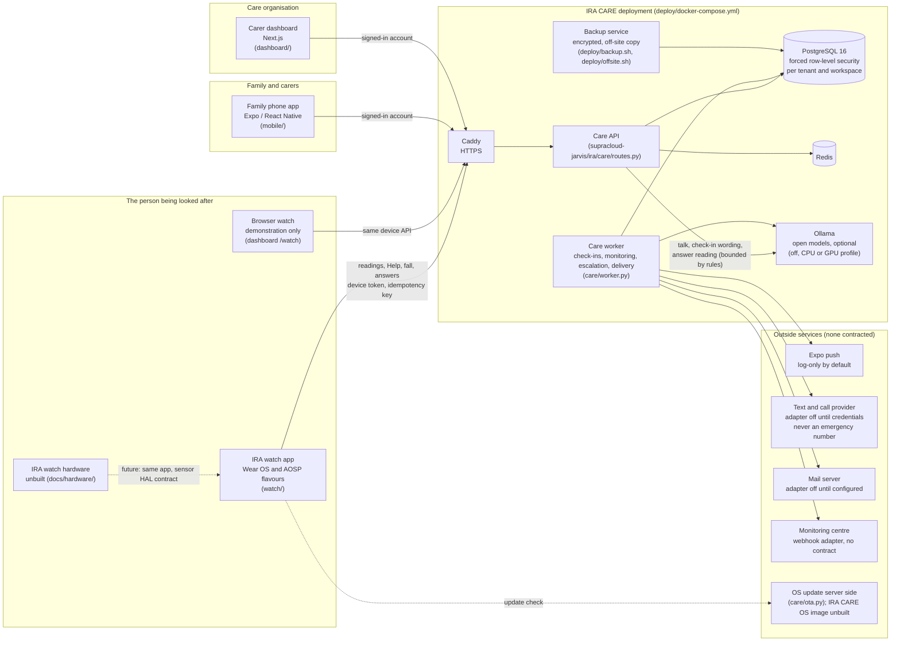
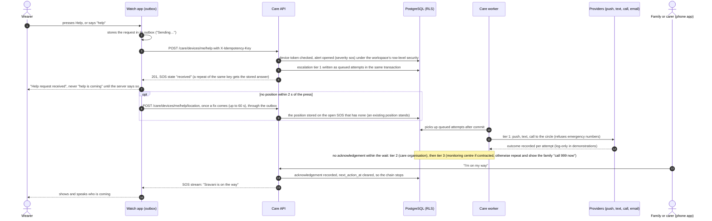
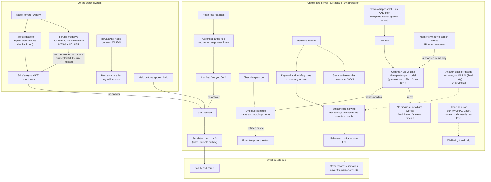

# IRA CARE: architecture diagrams

Written 25 November 2026 for the Innovator Founder endorsement and the investor demonstration.
Three diagrams, in Mermaid (GitHub renders them in place). Each one is drawn from the code and
names the files it comes from, so a reader can check it. Where a box is simulated, unbuilt or a
stand-in, the diagram says so.

- **Solid boxes** are built and tested in this repository.
- **Boxes marked "simulated", "unbuilt" or "log-only"** are exactly that today.
- Nothing in these diagrams has run on a physical watch or phone, or with real people.

## 1. System context

Who and what IRA CARE talks to. The care server is one deployment per operator; inside it,
every organisation (tenant) and workspace is separated by PostgreSQL row-level security.

Sources: `deploy/docker-compose.yml`, `deploy/compose.gpu.yml`, `deploy/compose.nomodel.yml`,
`supracloud-jarvis/ira/care/providers.py`, `supracloud-jarvis/ira/care/push.py`,
`docs/os/ARCHITECTURE.md`, `docs/evidence/staging/CONTAINERS.md`.

## 2. Data flow of a Help request

What happens between the wearer pressing Help (or saying "help") and the watch showing that
someone is on the way. Steps the code guarantees are in the notes; every provider in a
demonstration is log-only, so nothing leaves the machine and nothing dials anyone.

Sources: `supracloud-jarvis/ira/care/routes.py` (the device routes for Help and the SOS stream),
`supracloud-jarvis/ira/care/sos.py`, `supracloud-jarvis/ira/care/escalation.py`,
`supracloud-jarvis/ira/care/delivery.py`, `supracloud-jarvis/ira/care/providers.py`.
Tests: `supracloud-jarvis/ira/tests/tenancy/test_care_sos_db.py`,
`supracloud-jarvis/ira/tests/tenancy/test_care_escalation_db.py`,
`supracloud-jarvis/ira/tests/tenancy/test_care_delivery_db.py`,
`supracloud-jarvis/ira/tests/tenancy/test_care_journey_db.py`.

Measured through the browser watch against the real server (not a device):
reading upload to "are you OK?" question in 0.028 s (`docs/evidence/sample_to_alert.json`). Through
the containerised stack, a Help request under 50 simulated watches took 435 ms at the median and
807 ms at the 95th percentile (`docs/evidence/staging/containers.json`, a single shared machine).

## 3. Intelligence components and their safety boundaries

Which parts are learned models and which are fixed rules, and where the rules stand between a
model and anything that matters to safety. The rule: **no model can raise, suppress or close an
alert on its own, and no model can record a dose as taken.** The open conversation models only
word questions and replies; the deterministic rules decide.

What each boundary is held by:

| Boundary | Held by | Evidence |
| --- | --- | --- |
| Red-flag words always reach the rules, whatever the model says | keyword rules on every answer (D-056) | `supracloud-jarvis/ira/tests/care/test_care_safety_answers.py`, `docs/MODEL_CHOICE.md` (red-flag recall 1.00 for every model, because the rules run regardless) |
| Doubt never becomes "taken" | the stricter reading wins; `medication_taken: unknown` | `supracloud-jarvis/ira/tests/tenancy/test_care_safety_answers_db.py`, `docs/evidence/demo/REAL_MODEL_RUN.md` |
| One question at a time; fixed template on refusal or timeout | the one-question rule and time budgets in `care/conversation.py` | `docs/evidence/demo/REAL_MODEL_RUN.md` (the guard refused the model's wording in 2 of 8 runs) |
| No diagnosis or advice words in replies | reply guard and fallback line | `supracloud-jarvis/ira/tests/care/test_care_conversation_rules.py` |
| Memory and transcripts follow the person's consent | an authorised preference reaches the prompt; transcripts are private without recorded consent; the person or their representative can correct or clear what IRA remembers | `supracloud-jarvis/ira/tests/tenancy/test_care_journey_db.py` (step 6), `supracloud-jarvis/ira/tests/tenancy/test_care_conversation_db.py`, `supracloud-jarvis/ira/tests/tenancy/test_care_memory_db.py`, `supracloud-jarvis/ira/tests/care/test_care_personal_rules.py` |
| Fall model cannot remove a rule fall | recover mode: the rule detector still raises every fall it raises | `docs/ai/fall/MODEL_CARD_V3.md` |
| Activity and heart selector raise nothing | no alert path reads them | `supracloud-jarvis/ira/tests/care/test_activity_no_alert_path.py`, `docs/ai/heart/MODEL_CARD.md` |
| The system never dials emergency services | refused in the provider layer before any provider is reached | `supracloud-jarvis/ira/care/providers.py` |
| The product works with no model at all | `IRA_CARE_MODEL=off`: set questions and rules only | `deploy/compose.nomodel.yml`, `docs/MODEL_CHOICE.md` (rules-only row) |

Not shown because it does not exist yet: the IRA watch's own sensor hardware and sensor HAL
(`docs/hardware/SENSOR_HAL.md` is the contract), and the IRA CARE OS image (`docs/os/ARCHITECTURE.md`).
