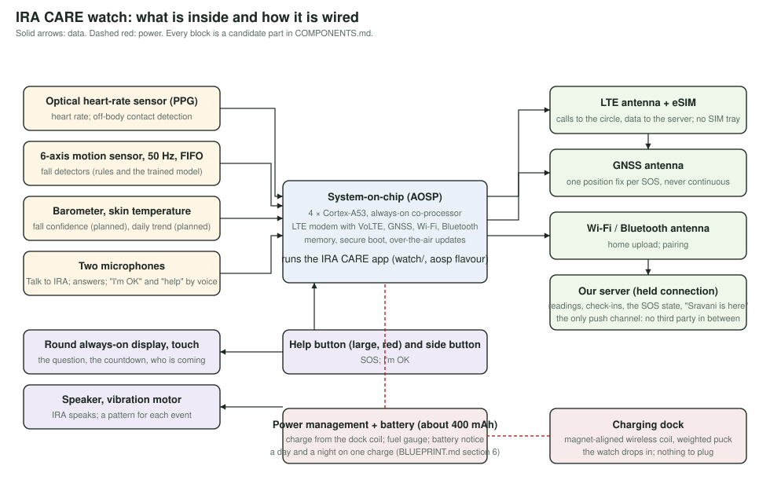
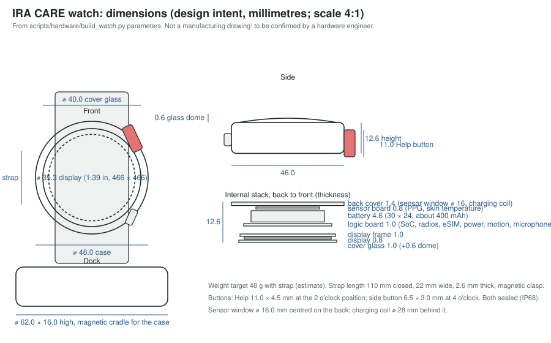

# The IRA CARE watch: a blueprint for an endorsing body

Plain English, for a reader who decides whether to back the device rather than build it. It
says what the watch is for, what is inside it and why, how long it lasts, what software runs
it, how it would be made, which approvals it needs in the UK, what that is likely to cost, and
what a hardware engineer must still do. Every figure in it is labelled: a measured number from
this repository, a figure read from a manufacturer's or regulator's page (with the link), or an
estimate. Nothing here has been built in hardware yet; the software it runs is in this
repository and is tested.

Companion files in this folder: `renders/` (the watch as it would look), `turntable.mp4`,
`viewer.html` (turn it, explode it, tap a part), `ira_watch.blend` and `ira_watch.glb` (the
model), `COMPONENTS.md` (candidate parts), `SENSOR_HAL.md` (the sensor contract),
`block_diagram.svg` and `dimensions.svg`.

## 1. Who wears it, and where

An older adult who lives alone, at home and about, 24 hours a day, including in bed, at the
sink and in the shower. It is charged on a dock at the bedside: the watch drops into a magnet-
aligned cradle; there is nothing to plug in or line up. The people around the wearer, family
and carers, see what the watch reports through a phone app and a dashboard. The companion on
the watch, IRA, speaks in short plain sentences, asks how the person is a few times a day,
listens, reminds, and tells the circle when something needs a person: a request for help, a
suspected fall, no answer together with no movement, a heart rate outside the range a carer
set, a carer's visit that did not happen.

The intended purpose of the whole service is written in `docs/compliance/INTENDED_PURPOSE.md`
(a draft for a qualified reviewer). That document is what decides, in section 9 below, whether
the watch is a consumer product or a medical device.

## 2. Each part, and the feature it serves

| Part | What it does for the person | IRA CARE feature |
| --- | --- | --- |
| Round always-on touch display, 1.39 to 1.43 inch, 466 × 466, under a domed cover | the time, the next visit, the question, the fall countdown, "Sravani is here", in large letters | home screen, check-ins, fall countdown, visit state |
| Large coral Help button on the side; smaller side button | one press tells the circle; the other says "I'm OK" | SOS with location; I'm OK during a check-in or a countdown |
| Two microphones and a loud speaker | IRA hears a quiet voice over a kettle; IRA speaks the question and the carer's name | Talk to IRA, check-in answers, "I'm OK" and "help" by voice, the communication profile's pace |
| Vibration motor | a firm pattern for a question, a repeat, a fall, a carer's arrival | haptics channel of the communication profile |
| Optical heart-rate sensor, skin contact, off-body detection | heart rate at its own time; whether the watch is worn | out-of-range alert, off-wrist notice and alert, fall gating |
| 6-axis motion sensor at 50 Hz with a FIFO; barometer | falls, movement, and (planned) the height drop before an impact | suspected fall (rules and the trained model), no-movement check |
| Skin temperature sensor | a trend for the daily report (planned) | reports |
| System-on-chip running plain Android (AOSP) with LTE and VoLTE, GNSS, Wi-Fi, Bluetooth; eSIM | its own line, calls to the circle, one position when help is needed, upload at home | everything; the app's `aosp` flavour |
| Battery, about 400 mAh, and power management | a day and a night on one charge, a battery notice to the carer | battery notice |
| Wireless charging coil and the dock | charging without a plug | charging |
| 316L steel case finished in graphite, sapphire-hard cover, medical-grade silicone strap with a magnetic clasp | 24-hour wear on older skin, fastened with one hand | wearing it at all |

Design-intent dimensions (from `scripts/hardware/build_watch.py`): case ⌀ 46.0 mm, 12.6 mm
high; cover glass ⌀ 40.0 mm, 1.0 mm plus a 0.6 mm dome; display ⌀ 35.3 mm active; strap 22 mm
wide; Help button 11.0 × 4.5 mm; sensor window ⌀ 16 mm; dock ⌀ 62 × 16 mm. Weight target 48 g
with strap (estimate).

## 3. The internal stack

Back to front, true to size in the model: back cover (1.4 mm, with the sensor window and the
charging coil behind it); sensor board (0.8 mm: optical heart-rate front end, skin
temperature, off-body detection); battery (4.6 mm, curved, about 400 mAh); logic board
(1.0 mm: system-on-chip and modem, Wi-Fi and Bluetooth, GNSS, eSIM, power management,
motion sensor, barometer, two microphones, speaker, vibration motor); the case with its two
buttons around them; display frame (1.0 mm); display (0.8 mm); cover glass (1.0 mm).
`renders/exploded.png` and the viewer show the same stack read from the top down: cover glass,
display, display frame, case with buttons, logic board, battery, sensor board, back cover, each
layer lifted clear of the one below and labelled on the part itself. `renders/section.png` is
the cut through the middle.

**The look.** One finish everywhere (D-072): a graphite case (`#2B2E33`), a coral Help button
(`#E2574C`), a slate strap, and the app's own screen colours. The Blender model, the eight
renders, the 20-second `turntable.mp4`, the glTF in `viewer.html` and the dashboard's browser
watch all use it; the colours are in `LOOK` in `scripts/hardware/build_watch.py`.

## 4. The software stack

| Layer | What it is | Where it is |
| --- | --- | --- |
| Operating system | Android Open Source Project (AOSP), no Google Play services, no Wear OS licence; a watch-sized system image from the chip vendor's board support package | the chip vendor's BSP; our build configuration (to be written with the engineering prototype) |
| Sensor HAL | the hardware abstraction layer the hardware must implement: the Android sensor types, rates, batching and wake behaviour the app depends on | `docs/hardware/SENSOR_HAL.md` |
| The IRA CARE watch app | Kotlin, Jetpack Compose; the `aosp` build flavour reads sensors through the Android framework, speaks through whatever engine the image has, and talks only to our server over its own held connection (no third-party push) | `watch/`, `README.md` there; D-059 |
| Secure boot and verified boot | the bootloader accepts only images signed with our key; Android Verified Boot checks the system partition at every start | planned with the BSP; a hardware engineer's and a platform engineer's task |
| Updates over the air | A/B system partitions updated from our own server with signed images; the app updates from the same server (there is no app store on the device) | planned: the server already serves the watch; the update channel is an addition to it |
| The server | the IRA CARE backend (FastAPI, PostgreSQL), the dashboard and the phone app in this repository | `supracloud-jarvis/ira`, `dashboard/`, `mobile/`; `docs/DEPLOY.md` |

## 5. Power budget and battery life

All figures here are **estimates** built from the component pages in `COMPONENTS.md` where a
figure was read (marked *page*) and from stated assumptions otherwise (marked *assumed*). The
target is **a day and a night on one charge: 30 hours** with the watch worn and speaking a few
times a day, so that a night of forgetting the dock does not leave the person without it.

| Consumer | Assumption | Average current |
| --- | --- | --- |
| Always-on display, dark background, a few bright words | 1.5 mA always-on, 60 mA when lit for 20 minutes a day (*assumed*; the panel page gives no power figure) | 2.3 mA |
| System-on-chip in deep sleep, waking once a minute to upload | 2 mA average (*assumed*; Qualcomm publishes no current) | 2.0 mA |
| LTE modem, idle on the network, a few calls and uploads | 1.5 mA sleep (*page*, EG915U class), 12.5 mA idle bursts, calls at 200 mA for 10 minutes a day | 4.0 mA |
| Optical heart-rate sensor, one sample a second | under 20 µA at 25 samples/s (*page*, AS7058) plus LED current, 0.5 mA average (*assumed*) | 0.5 mA |
| Motion sensor at 50 Hz | 0.7 mA at full rate (*page*, BMI270 685 µA) | 0.7 mA |
| Barometer, skin temperature, off-body | microamps (*page*: 1.3 µA, 3.5 µA) | 0.1 mA |
| Microphones (two, always ready for the wake word via one low-power microphone) | 20 µA wake mode (*page*, T5838 class), 1 mA while listening for 30 minutes a day | 0.1 mA |
| Speaker and amplifier | 5 minutes of speech a day at 300 mA (*assumed*) | 1.0 mA |
| Vibration | 20 patterns a day, 58 mA for 1 s each (*page*, VG0832013D) | 0.02 mA |
| GNSS | one fix a day at 10 mA for 30 s (*page*, MIA-M10Q) | 0.01 mA |
| Wi-Fi at home, uploads | 1 mA average (*assumed*) | 1.0 mA |
| **Total** | | **about 11.7 mA** |

A 400 mAh cell at 3.8 V nominal holds about 1.5 Wh; at 11.7 mA average the estimate is about
34 hours, which meets the 30-hour target with a small margin. The margin is thin: the two
largest unknowns are the modem's real standby current on UK networks and the display's
always-on power, and both are measured, not assumed, at the engineering-prototype stage
(section 7). If the budget fails, the first levers are a lower always-on refresh and a
battery of 450 mAh (the case has 1 mm of spare height in the model).

## 6. The manufacturing route

1. **Development board** (now to month 3): the chip vendor's watch reference board or an
   off-the-shelf AOSP-capable board with the sensors from `COMPONENTS.md` on a daughter board;
   the `aosp` flavour of the app runs on it unchanged; the sensor contract is checked against
   `SENSOR_HAL.md` section 5. Output: measured sensor behaviour and a first power measurement.
2. **Engineering prototype** (months 3 to 8): our own logic and sensor boards in the real
   stack, a 3D-printed and then machined case, the antenna design, the first dock. Output:
   the power budget measured, the fall detectors run on real falls on a mat, pre-compliance
   radio and SAR measurements.
3. **Design prototype** (months 8 to 12): the production case, sealing, strap and dock;
   industrial design frozen; formal testing starts (section 9).
4. **Production prototype** (months 12 to 16): the contract manufacturer's tooling and line;
   a pilot run of a few hundred units for the wear trial with real households; certification
   completes.
5. **Production** (from month 16): volume with the contract manufacturer; the server, the
   dashboard and the apps in this repository are already built and tested.

Contract manufacturers for wearables of this kind operate in the UK and in Europe (for the
pilot) and in Asia (for volume); the choice is a procurement decision with the hardware
engineer. All timings are **estimates** by the author of this document, not quotations.

## 7. What a hardware engineer must still do

- Circuit-board design: the logic board (the system-on-chip, its memory, the modem path or
  module, the radios, eSIM, power management, sensors, audio) and the sensor board, with the
  flexible connection between them and the battery.
- Enclosure CAD for manufacture: the case, the sealing (O-rings at the back cover and the
  buttons, the gasket under the glass), the button mechanisms, the lugs, the dock; the model in
  this folder is the design intent, not a tooling drawing.
- Antenna design: LTE, GNSS, Wi-Fi and Bluetooth in a 46 mm metal case, with the case gap as
  the slot antenna and the ground plane tuned; measured, then re-measured on the wrist.
- The battery and charging: the cell choice (a current 5 W wireless transmitter part, or our
  own dock controller: `COMPONENTS.md` found the wearable-class Qi transmitter controllers
  end-of-life), the thermal path, and the fuel gauge.
- The sensor HAL for the chosen chip, against `SENSOR_HAL.md`.
- Verification of every figure in `COMPONENTS.md` marked *not verified*, and the full
  datasheets of the verified ones.

## 8. The certification roadmap for the UK (with the EU alongside)

Researched on 24 November 2026 from the official pages linked; everything marked *official*
was read on gov.uk, legislation.gov.uk, EUR-Lex, ETSI, the IEC webstore, GCF, PTCRB or GSMA.
Cost and timeline figures are **estimates from the sources named** and are not quotations.

### 8.1 Radio equipment: UKCA under the Radio Equipment Regulations 2017, CE under RED 2014/53/EU

- **What it means.** Before the watch is sold in Great Britain it must meet the essential
  requirements of the Radio Equipment Regulations 2017 (SI 2017/1206): safety, electromagnetic
  compatibility, efficient use of spectrum; be conformity-assessed; carry a UKCA or CE mark;
  and have a declaration of conformity and a technical file kept for 10 years (*official*).
- **CE is accepted in Great Britain indefinitely** for this regime: the Product Safety and
  Metrology etc. (Amendment) Regulations 2024, in force 1 October 2024, extend recognition of
  CE marking indefinitely, so either mark may be used; until 31 December 2027 the UKCA mark may
  be on a label or an accompanying document (*official*, gov.uk guidance on using the UKCA
  marking). Medical devices are **not** covered by this recognition (section 8.8).
- **Designated standards for this device** (GB list v11, 3 November 2026, *official*): EMC
  EN 301 489-1, -17 (Wi-Fi and Bluetooth), -19 (GNSS), -52 (cellular); radio EN 301 908-1 and
  -13 (LTE), EN 300 328 (2.4 GHz), EN 303 413 (GNSS); RF exposure EN 50566:2017 (+A1:2023,
  +A2:2025) and EN 50360:2017; safety EN 62368-1 (the GB low-voltage list designates
  EN 62368-1:2014; test to the current EN IEC 62368-1 and cite the designated edition).
- **EU cybersecurity under RED** (*official*): Delegated Regulation (EU) 2022/30 applies from
  1 August 2025 and names "wearable radio equipment in the form of a wrist watch" in scope; the
  harmonised standards EN 18031-1/-2/-3:2024 are cited with restrictions (Decision (EU)
  2025/138): a device that lets the user run it with no password cannot self-declare and needs
  a Notified Body. The regulation is repealed with effect from 11 December 2027, when the
  Cyber Resilience Act applies. In Great Britain, EU-compliant CE-marked radio equipment is
  deemed to meet the 2017 Regulations, and the PSTI regime (8.7) applies in addition.
- **What to do.** Fix the intended purpose and claims (8.8) and the mark; test at an
  accredited laboratory against the standards above; assess EN 18031 for the EU; write the
  technical file and the declaration; keep both for 10 years; put a UK address on the product
  if the legal manufacturer is outside the UK.
- **Cost and time (estimate).** No official figure. Secondary sources quote €1,500 to €3,000
  for radio testing alone and $10,000 to $20,000 for a full intentional-radiator FCC and CE
  programme (ecocomply.ai; tek.com); a multi-band LTE wearable with SAR sits at the upper end.
  Sources: https://www.gov.uk/government/publications/radio-equipment-regulations-2017/radio-equipment-regulations-2017-great-britain ;
  https://www.gov.uk/guidance/using-the-ukca-marking ;
  https://www.gov.uk/government/publications/designated-standards-radio-equipment ;
  https://eur-lex.europa.eu/eli/reg_del/2022/30/oj/eng ; https://eur-lex.europa.eu/eli/dec_impl/2025/138/oj/eng

### 8.2 Battery safety and battery regulations

- **UN 38.3** transport tests on the cell and pack before shipping (altitude, thermal,
  vibration, shock, short circuit, impact or crush, overcharge, forced discharge); **IEC
  62133-2:2017 (+A1:2021)** for the safety of the lithium cell and pack (*official*, IEC
  webstore).
- **UK Batteries and Accumulators (Placing on the Market) Regulations 2008** (SI 2008/2164):
  substance limits (mercury, cadmium), the crossed-out-bin marking, and regulation 7: the
  appliance must be designed so the waste battery can be readily removed, with an exception
  where continuity of power is necessary for safety, performance, medical or data-integrity
  reasons and needs a permanent connection (*official*, legislation.gov.uk). A care alarm
  device has a case for the exception; it must be documented. Producer registration under the
  Waste Batteries and Accumulators Regulations 2009 (under one tonne a year: register with the
  environmental regulator; over: join a compliance scheme) (*official*).
- **EU Batteries Regulation (EU) 2023/1542** (*official*): CE marking of the battery itself,
  a declaration of conformity, removability and replaceability by the end user from
  18 February 2027 (with narrow derogations), labelling from 18 August 2026 and a QR code from
  18 February 2027.
- **Cost and time.** No credible published figure for UN 38.3 or IEC 62133-2 on a small
  pack; the cell supplier normally provides the reports. Sources:
  https://www.legislation.gov.uk/uksi/2008/2164/regulation/7/made ;
  https://www.gov.uk/guidance/regulations-batteries-and-waste-batteries ;
  https://eur-lex.europa.eu/legal-content/EN/TXT/HTML/?uri=CELEX:32023R1542 ;
  https://webstore.iec.ch/en/publication/32662

### 8.3 RoHS and WEEE

- **RoHS** (UK SI 2012/3032; EU Directive 2011/65/EU): the ten restricted substances within
  limits (0.1 % by weight in homogeneous material, cadmium 0.01 %), a technical file (EN IEC
  63000) and a declaration kept 10 years; CE accepted in Great Britain indefinitely where the
  rules match (*official*).
- **WEEE** (UK SI 2013/3113 as amended in 2025): register as a producer (under five tonnes a
  year: as a small producer with the environmental regulator, by 31 January each year; over:
  join a compliance scheme by 15 November), mark the crossed-out bin and the date, keep records
  four years; a non-UK producer appoints a UK authorised representative (*official*).
- **Cost and time.** Registration fees are not stated on the fetched pages (*not verified*);
  testing is supplier declarations plus spot tests. Sources:
  https://www.gov.uk/government/publications/restriction-of-hazardous-substances-rohs-regulations/rohs-regulations-2012-as-amended-great-britain ;
  https://www.gov.uk/guidance/electrical-and-electronic-equipment-eee-producer-responsibility

### 8.4 Radio-frequency exposure (SAR) on the wrist

- The watch must be shown not to exceed the localised SAR limits when worn on the wrist and
  when held to the face for a call: the EU and UK basic restrictions of Council Recommendation
  1999/519/EC (2 W/kg head and trunk, 4 W/kg limbs, averaged over 10 g: the limb figure is from
  the product standard's practice, *partially verified*), the product standard EN 50566:2017
  with its amendments (A2:2025 moves the body-worn separation to 0 mm, *search snippet*), and
  the measurement standard IEC/IEEE 62209-1528:2020 (*official*, IEC webstore). The US
  extremity limit, if ever needed, is 4.0 W/kg over 10 g (FCC KDB 447498, *search snippet*).
- **What to do.** Define the wearing positions and the maximum conducted power per band
  including simultaneous transmission; check the test-exclusion thresholds; otherwise test at
  an accredited SAR laboratory with wrist and flat phantoms; put the report in the technical
  file and the figures in the instructions.
- **Cost and time (estimate).** "A few thousand to tens of thousands of dollars" depending on
  the number of bands and positions (compliancetesting.com); a low-cost Asian laboratory quotes
  $500 to $3,000 (jjrlab.com). Sources:
  https://eur-lex.europa.eu/legal-content/EN/TXT/HTML/?uri=CELEX:31999H0519 ;
  https://webstore.iec.ch/en/publication/62753 ;
  https://www.element.com/connected-technologies/wireless-testing/specific-absorption-rate-sar-testing

### 8.5 IP68 and water resistance

- **IEC 60529** (BS EN 60529): IP6X is dust-tight (a talcum-powder chamber, up to 8 hours);
  IPX8 is continuous immersion under a depth and time the manufacturer states, more severe
  than IPX7's 1 m for 30 minutes (*official* standard, clause detail from laboratory pages).
  **ISO 22810:2010** governs the "water resistant" marking of watches (*search snippet*,
  iso.org refused access).
- **What to do.** State the IPX8 condition (for example 1.5 m for 30 minutes); test IP6X and
  IPX8 on production-representative samples after the button, microphone and speaker ports are
  frozen; run ISO 22810 if the dial is to carry a water-resistance mark; repeat after any
  enclosure change.
- **Cost and time (estimate).** $550 and 5 working days at a low-cost laboratory (jjrlab.com);
  about two weeks at Western laboratories, on quotation. Sources:
  https://webstore.iec.ch/en/publication/2452 ; https://www.iso.org/standard/45334.html ;
  https://www.element.com/product-qualification-testing-services/ip-ingress-protection-testing

### 8.6 Mobile network certification and eSIM

- UK operators publish no statutory approval; in practice an LTE device with voice is expected
  to be **GCF certified** (conformance testing at a recognised laboratory plus field trials on
  qualified networks; GCF's scope includes consumer eSIM remote provisioning and VoLTE), and
  **PTCRB** only for North America (*official*, GCF and PTCRB pages). A device built on a
  GCF-certified module can join GCF as an Associate Manufacturer II and run a reduced test set.
- **eSIM**: GSMA SGP.21 and SGP.22 (consumer remote SIM provisioning; v3.1 current) and SGP.24
  compliance, with the eUICC from a site certified under GSMA SAS-UP (*official*, GSMA
  specifications).
- **Network context**: the UK 3G networks are off and 2G ends by 2033 at the latest, so voice
  means 4G with VoLTE (*search snippet*, Ofcom).
- **Cost and time.** GCF membership €5,000 (Associate II) or €10,000 (full) a year
  (*official*); PTCRB certification fee $1,500 to $15,000 plus laboratory fees (*official*);
  GCF laboratory testing is not published (an older benchmark put LTE laboratory testing at
  $60,000 to $70,000, circuitcellar.com); under 8 weeks with a pre-certified module is a module
  vendor's claim (quectel.com). Operator interoperability testing for VoLTE is arranged with
  each network's device team (*not verified*: no public process found). Sources:
  https://www.globalcertificationforum.org/membership/become-a-member/device-app-vendors/membership-options.html ;
  https://www.ptcrb.com/get-certified/ ; https://www.gsma.com/esim/esim-specification/

### 8.7 The UK Product Security and Telecommunications Infrastructure (PSTI) regime

- From **29 April 2024** any internet-connectable consumer product sold in the UK must: have no
  universal default password (unique per device, or set by the user); publish how to report
  security issues, with acknowledgement and status timescales; publish the minimum period of
  security updates, with its end date, as prominently as the price; and be accompanied by a
  **Statement of Compliance** (the product, the manufacturer, the support period, a signature)
  kept by the manufacturer and importer (*official*: the PSTI Act 2022 Part 1 and SI
  2023/1007, Schedules 1 to 4). Conforming to the relevant provisions of ETSI EN 303 645 and
  ISO/IEC 29147 is deemed compliance.
- A **medical device** under the Medical Devices Regulations 2002 is excepted (but a phone on
  which regulated medical software runs is not) (*official*, Schedule 3): so the watch is in
  scope as a consumer product, and out of scope only if it becomes a medical device.
- **Penalties** (*official*, section 36 of the Act): enforcement, stop and recall notices;
  penalty notices up to the relevant maximum (the greater of £10 million and 4 % of qualifying
  worldwide revenue, *figure not re-verified from section 38*) plus up to £20,000 a day while a
  breach continues.
- **What this repository already does.** The watch pairs with a one-time code and holds a
  per-device token (no default password); the server's security contact and support period
  belong in the Statement of Compliance when the product is sold. No fees. Sources:
  https://www.gov.uk/government/publications/the-uk-product-security-and-telecommunications-infrastructure-product-security-regime ;
  https://www.legislation.gov.uk/uksi/2023/1007/schedule/1/made ;
  https://www.legislation.gov.uk/ukpga/2022/46/section/36/enacted

### 8.8 The MHRA medical-device route, only if a medical purpose is claimed

- **The deciding question** is the intended purpose. MHRA's guidance says the monitoring of
  general fitness, health and wellbeing is not usually a medical purpose, and that apps and
  software monitoring heart rate for fitness are not medical devices, while software intended
  to investigate physiological processes may be; a general disclaimer does not undo a medical
  claim (*official*, MHRA software guidance). `docs/compliance/INTENDED_PURPOSE.md` describes a
  companion and alerting service that notices events and tells people, and does not diagnose,
  treat or monitor a disease. **Kept to that language, the watch is a consumer product under
  sections 8.1 to 8.7, and none of this section applies.**
- **If a medical purpose is claimed** (for example, presenting the heart-rate alert as
  monitoring a heart condition): UK Medical Devices Regulations 2002 (SI 2002/618), most
  likely **Class IIa** for software that monitors physiological processes (by the EU MDR
  Annex VIII rule 11 analogue; the GB classification to be confirmed with the MHRA borderline
  service, *not verified*); conformity assessment by a UK Approved Body; UKCA marking (CE under
  EU MDR 2017/745 is accepted in Great Britain until 30 June 2030, *official*); registration
  with the MHRA before placing on the market (from 1 April 2026, £300 per GMDN category per
  year, *official*); and the **post-market surveillance regime in force since 16 June 2025**
  (SI 2024/1368): a PMS system and plan, periodic safety update reports every two years for
  Class IIa, serious incidents reported within 2, 10 or 15 calendar days by kind, trend
  reporting and field safety notices (*official*). The quality system (ISO 13485), risk
  management (ISO 14971), software lifecycle (IEC 62304), electrical safety for medical
  equipment (IEC 60601-1 and -1-11) and a clinical evaluation follow.
- **Cost and time (estimate).** No UK Approved Body publishes UKCA Class IIa fees (*not
  verified*). EU MDR comparators: a Class IIa technical-documentation assessment €9,600 (Kiwa
  price list), a BSI audit day €2,185, and a vendor estimate of €32,000 to €110,000 and 9 to 18
  months for a whole Class IIa project (meddeviceguide.com). Sources:
  https://www.gov.uk/guidance/medical-devices-how-to-comply-with-the-legal-requirements ;
  https://www.gov.uk/guidance/register-medical-devices-to-place-on-the-market ;
  https://www.gov.uk/government/publications/medical-devices-post-market-surveillance-requirements/vigilance-reporting-requirements ;
  https://www.gov.uk/government/news/ce-marking-recognition-for-medical-devices-and-in-vitro-diagnostics ;
  MHRA software guidance: https://assets.publishing.service.gov.uk/media/6abf6c8c943e890cb55e5e52/Medical_device_stand-alone_software_including_apps__including_IVDMDs.pdf

### 8.9 Cost and timeline summary (all estimates unless marked official)

| Item | Cost | Time | Status of the figure |
| --- | --- | --- | --- |
| Radio, EMC and safety testing (LTE wearable, UKCA/CE) | €1,500 to €3,000 radio alone; $10,000 to $20,000 for a full programme; higher for a multi-radio wearable with SAR | 4 to 8 weeks of laboratory time | estimate (ecocomply.ai, tek.com) |
| SAR | a few thousand to tens of thousands of dollars | 1 to 3 weeks | estimate (compliancetesting.com) |
| GCF | €5,000 to €10,000 a year membership (official); laboratory testing not published (older benchmark $60,000 to $70,000) | under 8 weeks with a pre-certified module (vendor claim) | partly official |
| PTCRB (North America only) | $1,500 to $15,000 certification fee (official) plus laboratory fees | depends on the device | official fee |
| IP68 | $550 at a low-cost laboratory; Western laboratories on quotation | 5 working days to 2 weeks | estimate |
| PSTI, RoHS, WEEE, battery registration | no statutory fees beyond registration or scheme charges | continuous obligations | official (fees not fetched) |
| MHRA registration (only if medical) | £300 per GMDN category per year (official) | | official |
| UKCA Class IIa conformity assessment (only if medical) | no UK fee schedule published; EU comparators €9,600 for the document review, €32,000 to €110,000 for a project | 9 to 18 months | estimate |

### 8.10 What this roadmap could not verify

The PSTI maximum-fine figure from section 38 of the Act itself; the limb SAR limit table
cells in Recommendation 1999/519/EC; the clause-level test durations of IEC 60529 and the
parameters of ISO 22810 (paywalled standards); any public UK operator acceptance process; the
WEEE category for a care watch; any UK Approved Body fee schedule.

## 9. What is proved, what is estimated, what needs the owner

- **Proved in this repository:** the watch software runs in two flavours and the `aosp`
  flavour has no Google dependency (CI); the sensor contract is written; the model in this
  folder builds from a script with every part named and true to the design-intent dimensions;
  the viewer works on a phone and a desktop (checked in a headless browser).
- **Estimated here:** the power budget, the weight, the timeline, every cost.
- **Needs the owner:** a hardware engineer (section 7); a decision on the intended purpose
  (section 8.8); the choice of contract manufacturer; the regulatory adviser's review of
  section 8 before any submission.
